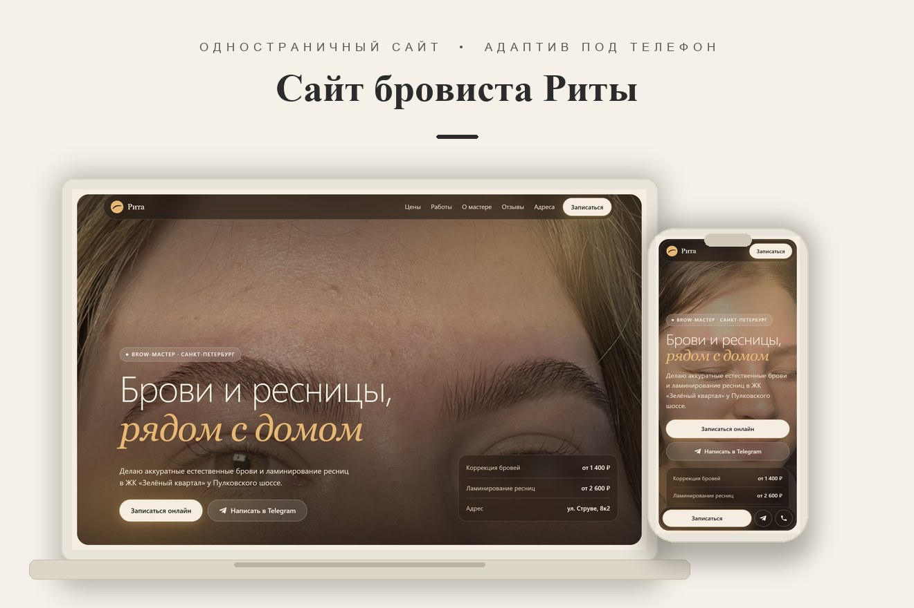

# Рита: брови и ресницы

Статический сайт-лендинг brow-мастера в Санкт-Петербурге (ЖК «Зелёный квартал», ул. Струве, 8к2).

**Опубликован:** https://brov-rita.vercel.app/ (Vercel)
**Репозиторий:** https://github.com/alyvlad1975-lang/brov-rita

## Файлы

- `index.html`: главная страница
- `privacy.html`: политика обработки персональных данных
- `styles.css`, `script.js`: оформление и скрипты (вкладки прайса, просмотр фото, Яндекс Метрика по согласию)
- `img/`: фото работ и студии в WebP
- `favicon.svg`, `robots.txt`, `sitemap.xml`: служебные файлы для поиска
- `.htaccess`: защитные заголовки для хостинга на Apache
- `vercel.json`: те же защитные заголовки для Vercel (Apache-файл Vercel не читает)

## Публикация

Сборка не нужна: это статические файлы.

1. Vercel: новый проект, Framework Preset «Other», Build Command — пусто, Output Directory — `.` (корень репозитория).
2. Или через CLI: `vercel --prod` из корня папки.
3. Домен проекта: `brov-rita.vercel.app`. При смене домена обновить ссылки в `index.html` (canonical, og:url, og:image, JSON-LD), `robots.txt`, `sitemap.xml` и `privacy.html`.

## Что доделать

- `index.html`, раздел «О мастере»: вместо `[ЗАПОЛНИТЬ: фото сертификатов и названия обучений]` вставить фото сертификатов и названия обучений.
- `privacy.html`: вписать e-mail для обращений по персональным данным и показать текст юристу.
- `script.js`: Метрика включена, счётчик `114333108` (Вебвизор, карта кликов, внешние ссылки, точный отказ). Уведомление о cookie показывается при первом визите.
